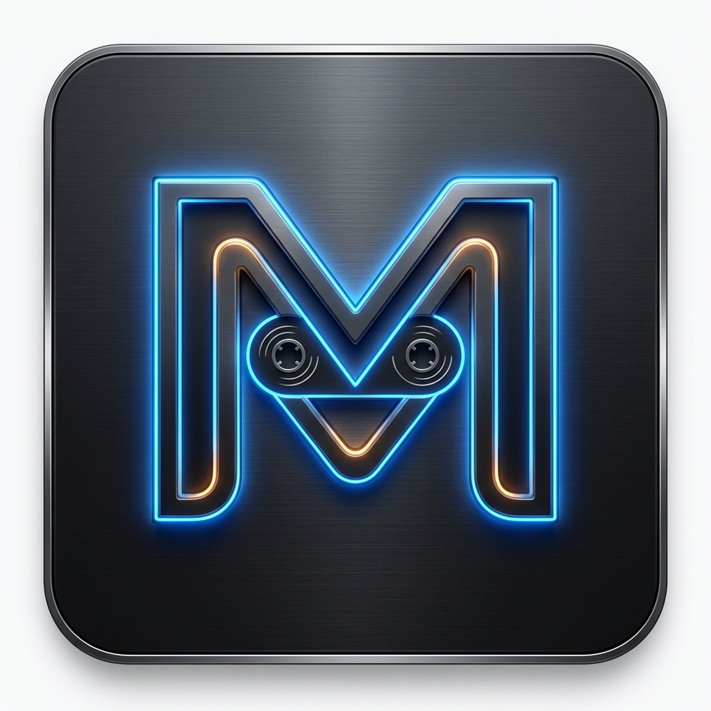
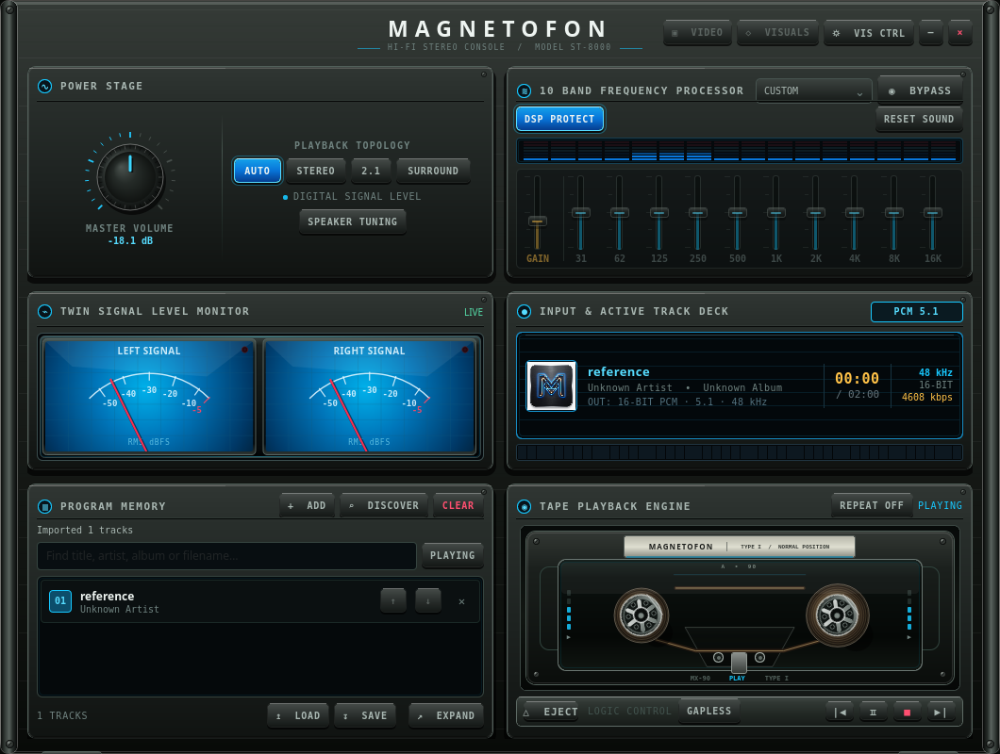

# Magnetofon (ST-8000) — Native C++ Edition

<p align="center">
  
</p>

<h3 align="center">Magnetofon ST-8000 — Native Hi-Fi Music & Concert Video Console</h3>

<p align="center">
  Magnetofon is a high-performance desktop music and concert-video console built with <strong>C++17</strong>, <strong>Qt 6 QML (OpenGL Scene Graph)</strong>, and <strong>libmpv</strong>. Styled after high-end McIntosh sapphire blue glass faceplates and Sony ES 3D extruded metallic hardware.
</p>

<p align="center">

  <a href="#key-features">Features</a> •
  <a href="#-interface-showcase">Gallery</a> •
  <a href="#playlist--library-discovery">Library</a> •
  <a href="#installation--build">Setup & Build</a> •
  <a href="#architecture">Architecture</a>
</p>

---

## Overview & Performance Highlights

**Magnetofon ST-8000** combines the physical tactile elegance of vintage 1980s/1990s Japanese and American audiophile component stacks with a **pure C++17 engine**, direct `libmpv` C++ audio pipeline, and hardware-accelerated **Qt Quick OpenGL Scene Graph** rendering.

- **Native Qt Quick UI**: Uses the Qt scene graph for composition, with CPU-rasterized QPainter/Canvas elements where appropriate. Frame time and responsiveness depend on hardware and workload.
- **No embedded browser runtime**: Memory use varies with media, artwork, video decoding and the optional external visualizer; no fixed RSS guarantee is made.
- **Direct `libmpv` C++ Audio Engine**: No IPC bridge overhead. Audio properties, PCM meter physics, equalizer filters, and channel-aware routing run natively in C++.
- **Direct Multichannel PCM Decode**: FLAC, DTS/DTS-HD, Dolby Digital, Dolby Digital Plus, and Dolby TrueHD sources are decoded directly to PCM with native 5.1/7.1 channel layouts preserved whenever the output device supports them.
- **Synchronized Concert Video**: Music videos play in a separate Qt-owned, hardware-accelerated window driven by the same `libmpv` instance as the audio, keeping transport and A/V sync unified.
- **Smart Library Discovery**: Select or drop a music folder to recursively discover supported tracks across nested artist, album, and disc directories with natural ordering and duplicate prevention.
- **Portable Playlist Files**: Load standard `.m3u`/`.m3u8` playlists or save the current queue as a UTF-8 M3U8 playlist with portable relative paths.
- **McIntosh Sapphire Blue VU Meters**: Custom C++ `QQuickPaintedItem` dual-needle display with cached dial artwork. Rendering cadence and measurement availability depend on the audio/backend configuration.
- **Frameless Windowless Console**: Native desktop integration with seamless titlebar window dragging (`startSystemMove()`), minimize, and close controls.

---

## 📸 Interface Showcase

<p align="center">
  
</p>


---

## Key Features

### Hi-Fi Audio Console Modules
- **Power Stage (`AmplifierPanel`)**: Tactile master-volume knob with calibrated software attenuation; explicit `AUTO`, `STEREO`, `2.1` and `SURROUND` modes, independent speaker profiles and switchable enhanced-DSP overload protection.
- **Twin Signal Level Monitor (`VuMeterPanel`)**: Dual McIntosh cyan blue VU meters painted with QPainter and composited by the Qt scene graph, with peak warning LEDs.
- **10-Band Frequency Processor (`EqualizerPanel`)**: 16-band real-time spectrum analyzer, EQ preset selector, `POWER: ON / BYPASS` toggle, gain slider, and 10 EQ frequency band sliders.
- **Input & Active Track Deck (`ProgramMonitorPanel`)**: VFD screen displaying album art, track details, source codec/layout, decoded PCM output, selectable container audio tracks, timing information, and a segmented seek bar.
- **Program Memory (`PlaylistPanel`)**: Music and video queue with individual-file loading, recursive folder discovery, file/folder drag-and-drop, duplicate prevention, and M3U/M3U8 playlist persistence.
- **Music Video Window (`VideoWindow`)**: Automatically opens for video media, supports normal window resizing/maximizing, and can be hidden or reopened with the `VIDEO` control without interrupting audio playback.
- **Tape Playback Engine (`CassettePanel`)**: Maxell UR90 tape shell with 4 corner slotted screws, Maxell label block, window guide bands, rotating reels, metallic cassette head assembly, and 3D metallic transport push-buttons.

---

## Supported Media Formats

Magnetofon handles media natively through `libmpv` and FFmpeg:

### Audio

- **Lossless**: FLAC, WAV, AIFF, AIF, ALAC
- **Surround codecs**: DTS, DTS-HD High Resolution, DTS-HD Master Audio, Dolby Digital (AC-3), Dolby Digital Plus (E-AC-3), Dolby TrueHD/MLP, multichannel FLAC, and LPCM
- **Multichannel routing**: Native 5.1/7.1 PCM output in Auto and Surround modes; proper stereo downmix; mono/stereo-to-5.1 upmix in Surround mode
- **Compressed**: MP3, AAC, M4A, OGG, OPUS, WMA, MP2

Compressed surround tracks are decoded to PCM in memory. Magnetofon does not create temporary converted files and does not enable S/PDIF/HDMI compressed bitstream passthrough. TrueHD and DTS-HD MA therefore retain their lossless channel data; AC-3 and standard DTS are reproduced faithfully without another lossy encoding stage.

### Speakers & subwoofer

- **Auto** preserves the source layout and bypasses speaker tuning. With EQ bypassed, the enhancement/limiter graph is bypassed too.
- **Stereo** explicitly downmixes native multichannel material to two channels, including on a surround-capable output.
- **2.1** enhances mono/stereo with front speakers and a generated subwoofer signal. It uses a 5.1 carrier with only FL, FR and LFE active for compatibility with surround devices. Native multichannel tracks remain untouched in this mode.
- **Surround** bass-manages native 5.1 without downmixing, or upmixes mono/stereo to 5.1. Both rear (`5.1`) and side (`5.1(side)`) surround layouts retain their channel mapping. Other native layouts, including 7.1, pass through unchanged.
- **SPEAKER TUNING** has independent **2.1 Stereo** and **5.1 Surround** profiles. It opens on the current enhancement mode; selecting a settings tab does not change playback mode.
  - **2.1:** shared front-speaker high-pass, subwoofer low-pass, and subwoofer level. Existing stereo settings are retained. Defaults: 80 Hz / 80 Hz / 0 dB.
  - **5.1:** individual high-pass cutoffs for front left, front right, center, surround left, and surround right. Removed bass is summed into the original LFE, with a separate subwoofer low-pass and level. Defaults: 80 Hz for each speaker, 120 Hz subwoofer low-pass, 0 dB level.
  - Speaker cutoffs: 0/full-range–200 Hz; subwoofer low-pass: 40–200 Hz; subwoofer level: −12 to +6 dB. Filters are 12 dB/octave. Each profile saves and resets independently.
- Select an output-device profile exposing a physical LFE channel to hear the subwoofer signal.
- Every launch deliberately starts with the volume knob at 50%. The displayed attenuation follows the supported mpv software gain law (about −18.1 dB at 50%), not the old decorative linear scale.
- **DSP protection** is enabled by default for enhanced processing: a linked look-ahead peak limiter without automatic make-up gain protects bass redirection/EQ output. It is not album loudness normalization. Bypassing protection is explicit; unprocessed Auto playback is not passed through it.
- EQ, playback topology, repeat policy and speaker profiles are remembered. The last queue/track/position is restored **paused**, never autoplayed; session snapshots stay in your private application data directory.
- In windowed visuals, drag the top strip to move the window, or any edge/corner to resize it, including in borderless mode.

### Signal metering

On Linux with PulseAudio-compatible capture, the VU meters and spectrum measure only Magnetofon's own playback stream, not the whole system mix. Capture is asynchronous and follows the stream's output device. The calibrated meter face shows stereo-monitor RMS dBFS, not amplifier watts or speaker power. The meter header shows **LIVE** only while recent samples are available; otherwise it shows **METER UNAVAILABLE** (or **IDLE** while stopped). Unsupported capture, including the current Windows build, displays no invented audio activity.

### Music Video

- **Containers**: MKV, MKA, MP4, M4V, MOV, WebM, M2TS, MTS, TS, VOB, and AVI
- **Video codecs**: Determined by the installed/bundled `libmpv` FFmpeg runtime; tested with H.264, HEVC, MPEG-2, VC-1, and AV1
- **Multiple audio tracks**: The container default is selected initially; alternate mixes, languages, and stereo/surround tracks can be selected from the active-track deck
- **Video output**: Hardware decoding is attempted safely with automatic software fallback. Closing the video window hides the picture while playback continues; the `VIDEO` button restores it.
- **Application lifecycle**: Closing the main console stops playback and terminates the video and visualizer processes cleanly, even when auxiliary windows are open.

---

## Playlist & Library Discovery

The **PROGRAM MEMORY** panel provides four library controls:

- **ADD**: Select one or more individual music or video files.
- **DISCOVER**: Select a folder and recursively add supported media from all nested artist, album, and disc folders.
- **LOAD**: Replace the current queue with a saved `.m3u` or `.m3u8` playlist.
- **SAVE**: Save the current queue as a UTF-8 `.m3u8` playlist. Media paths are stored relative to the playlist file where possible, making playlists portable with their library folder.

Opening media from the file manager reuses the running player and appends to its queue without interrupting the active track. Scroll the queue with the mouse wheel or by dragging. Use the compact search to find queue entries, and reveal the playing track without changing playback. Click a row to highlight it; ↑/↓ navigate, while Ctrl+↑/↓ and the row move buttons reorder. Double-click or Enter activates the highlighted track, including the current stopped/paused track. The active track retains its illuminated track number.

Discovery, dropped folders and file-manager imports run in the background in bounded batches. The playlist shows progress and offers **CANCEL**; cancelling retains tracks already added, while **CLEAR** cancels outstanding work and empties the queue. Save/load failures appear in the playlist panel. Playback can continue while an import runs.

Files are naturally ordered by folder and filename, so names such as `Album 2` precede `Album 10` and track `02` precedes track `10`. Existing queue entries are not duplicated. You can also drag individual files or an entire folder directly onto the playlist panel.

Explicit selections and extensionless tracks are content-probed rather than rejected solely by filename suffix; discovery includes the supported raw surround formats. Missing/unsupported import entries are reported. Playback failures show an explanation and Retry/Skip controls instead of silently looking paused.

The console keeps its hi-fi materials at a readable control scale. Narrow windows use a scrollable component arrangement; the cassette keeps its proportions. Volume, EQ and seek support keyboard/accessibility actions. Space toggles play/pause outside text input; transport/volume shortcuts are available without adding another window.

### Continuous albums / gapless playback

The **GAPLESS** button in **TAPE PLAYBACK ENGINE** enables continuous album playback. It lights cyan when enabled and remembers its state between launches (off by default).

Magnetofon queues the remaining tracks inside the audio engine before playback starts, prefetches upcoming media, and keeps compatible audio output/DSP settings intact across track boundaries. There is no crossfade, overlap, or automatic silence trimming. Embedded silence remains part of the recording; uninterrupted output works best when adjacent tracks share their sample rate and channel layout.

Queue edits, manual track selection, pause, and stop remain available. Repeat is independent: **OFF** stops at the end, **ALL** repeats the queue and **ONE** repeats the current track. The same policy applies with Gapless on or off. Gapless controls continuity only, not whether the album repeats.

### Native visuals availability

The bundled native projectM runtime is currently supplied for **Linux x86-64**. Windows packages do not include projectMSDL or curated presets; the app reports unavailable native visuals instead of offering a nonfunctional launch. A supported external runtime and curated assets must be supplied together before enabling that feature on another platform.

Linux visuals capture only the parent Magnetofon process's playback stream using the same bounded asynchronous libpulse capture implementation as the meters. Capture follows that stream when its output changes; it never falls back to the system mix or a microphone. **Rendering** and **Audio Live** are separate statuses, with freshness/recovery reporting. This is output-stream capture, not a second decoder, and does not certify physical speaker output. The helper requires the bundled Magnetofon-specific projectM frontend.

Fullscreen controls are **F** or **F11** to toggle, **Escape** to return to a window, and **G** for the projectM settings overlay.

### Visual Preset Library

The bundled curated presets remain in the read-only application resources. The optional full preset pack is downloaded into a staged, versioned per-user library and activated only after extraction completes; administrator privileges are not required. On Linux this is normally beneath `~/.local/share/Magnetofon/`. The managed pack lives in `visuals-managed-packs`, separate from loose legacy/custom presets under `visuals`. **MY PRESETS** keeps those custom files selectable even while a verified full pack is active; an unverified old library is not advertised as a completed download.

---

## Release notes

[v2.2.0 — dependable listening and integrated visuals](docs/releases/v2.2.0.md). Linux x86-64 includes native projectM and stream metering. Windows includes native playback/video but does not claim those Linux-only capture/visuals features. Prebuilt Linux bundles target Ubuntu24.04/Mint22-generation systems; source builds can target other compatible distributions. Published bundles carry checksums; hosted startup checks do not replace physical speaker/video/device testing.

## Installation & Build

### System Dependencies (Linux / Ubuntu / Debian)

```bash
sudo apt update
sudo apt install build-essential cmake qt6-base-dev qt6-declarative-dev qt6-tools-dev \
  libmpv-dev libpulse-dev libavformat-dev libavcodec-dev libavutil-dev libavfilter-dev libx11-dev \
  pkg-config unzip
```

### Quick Run

To build and run Magnetofon Native directly from the repository:

```bash
./run.sh
```

`run.sh` performs an incremental CMake configure/build before launching, so local source and QML changes are always reflected in the executable.

### Playlist interaction regression check

With Qt's QML test runner and the QtTest QML module installed:

```bash
QT_QPA_PLATFORM=offscreen QT_QUICK_BACKEND=software /usr/lib/qt6/bin/qmltestrunner -input src-cpp/tests/qml
```

This exercises mouse-wheel and drag scrolling, independent row selection, keyboard/button reordering, and Enter-to-play.

### Native regression tests

```bash
cmake -S src-cpp -B test-build -DBUILD_TESTING=ON -DCMAKE_BUILD_TYPE=RelWithDebInfo
cmake --build test-build --parallel 2
QT_QPA_PLATFORM=offscreen QT_QUICK_BACKEND=software ctest --test-dir test-build --output-on-failure
```

Install `qml6-module-qttest` to run the QML interaction check and `unzip` for the synthetic preset-installation tests. Without the optional `MAGNETOFON_*_TEST_FILE` video/FLAC fixture paths, four external-media integration cases report skips; CI generates these fixtures. Test builds use null/PCM output and never record your live audio server. To instrument the application **and** native test targets, configure a separate build with `-DMAGNETOFON_ENABLE_SANITIZERS=ON`.

### Manual Compilation via CMake

```bash
cmake -S src-cpp -B src-cpp/build -DCMAKE_BUILD_TYPE=Release
cmake --build src-cpp/build --parallel
./src-cpp/build/MagnetofonNative
```

---

## Architecture

```
Magnetofon/
├── run.sh                     (Root launch script)
├── run_native.sh              (Native C++ build launcher)
└── src-cpp/
    ├── CMakeLists.txt         (CMake configuration for Qt 6 & libmpv)
    ├── main.cpp               (QApplication, setlocale, & QML engine startup)
    ├── audio/
    │   ├── AudioPlayer.hpp    (C++ QObject wrapping libmpv with Q_PROPERTY bindings)
    │   ├── AudioPlayer.cpp    (Unified audio/video playback, PCM decode, EQ & routing)
    │   ├── AudioRouting.cpp   (Auto/stereo/surround channel-routing policy)
    │   └── TrackMetadataReader.cpp (FFmpeg audio, video, and container metadata)
    ├── models/
    │   ├── PlaylistModel.hpp  (Track queue, recursive discovery & playlist API)
    │   └── PlaylistModel.cpp  (Metadata loading, natural ordering & M3U8 persistence)
    └── ui/
        ├── VideoWindow.cpp    (Qt-owned native video window embedded with libmpv)
        ├── VuMeterItem.hpp    (Custom QQuickPaintedItem for McIntosh Cyan Dual VU)
        ├── VuMeterItem.cpp    (Cached QPainter dial and dual needles)
        ├── qml.qrc            (QML resource bundle)
        └── qml/
            ├── main.qml               (Frameless main window & metallic chassis)
            ├── HifiPanel.qml          (3D Extruded Panel Container)
            ├── HifiButton.qml         (Tactile 3D Metallic Push Button)
            ├── Knob.qml               (Tactile Knurled Master Volume Dial)
            ├── EqSlider.qml           (Vertical EQ Slider)
            ├── AmplifierPanel.qml     (Power Stage Module)
            ├── VuMeterPanel.qml       (Twin Signal Monitor Module)
            ├── EqualizerPanel.qml     (10-Band EQ & Spectrum Analyzer Module)
            ├── ProgramMonitorPanel.qml (VFD Display & Progress Deck Module)
            ├── CassettePanel.qml      (Tape Playback Engine Module)
            ├── CassetteDeck.qml       (Maxell UR90 Cassette Shell & Reels)
            └── PlaylistPanel.qml      (Program Memory Queue Module)
```

---

## License

Magnetofon is licensed under the GPL-3.0 License.
